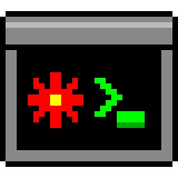
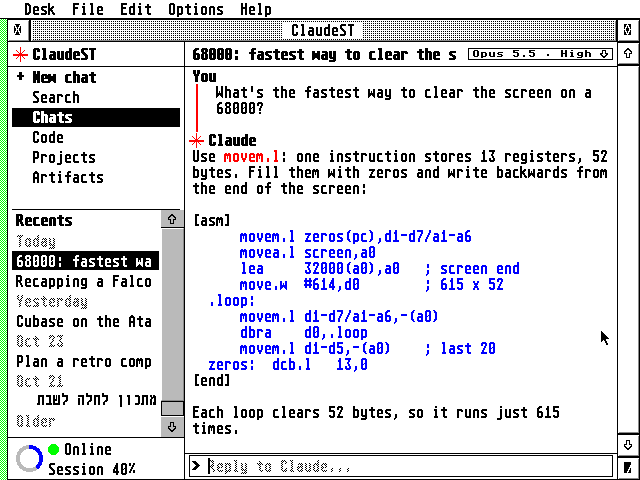

# ClaudeST



A native GEM client for [claude.ai](https://claude.ai) on the Atari ST,
STE, Mega ST/STE, TT and Falcon.



It works like the claude.ai website: chats, Search, Code, Projects and
Artifacts on the left, the open conversation on the right, and replies
streaming in as Claude writes them.

- Your real claude.ai account: recent and pinned chats, projects, search
- Claude Code sessions: read them and reply
- Artifacts: view them and save them to disk, Word documents included
- Model and effort for each chat, from a chip in the title bar
- Right-click menus: Pin, Rename, Move to project, Archive, Delete
- A ring that fills as you use up the current session, and an Account
  page with your plan and usage
- Hebrew: right-to-left text and a Hebrew keyboard layout
- A font selector (Options ▸ Font), as in EMail and ECal: the system
  font in two sizes, or any fixed-width GDOS font with NVDI
- Monochrome and colour, any resolution from 640×200

The [user guide](docs/GUIDE.md) describes every feature.

ClaudeST was first called Claude ST, then EClaude for a few days. To
upgrade, replace `CLAUDE.PRG` or `ECLAUDE.PRG` with `CLAUDEST.PRG`: your
settings in `CLAUDE.INF` or `ECLAUDE.INF` are read the first time, then
saved as `CLAUDEST.INF`. The Raspberry Pi side keeps its service name,
`claude-st`.

## How it works

```
Atari (CLAUDEST.PRG)  <-- STinG or serial -->  Raspberry Pi (bridge)  <-- HTTPS -->  claude.ai
```

An 8 MHz 68000 can't do modern HTTPS, so a small Python program, the
bridge, runs on a Raspberry Pi or any Linux computer on your network.
The Atari reaches it through STinG, over Ethernet or WiFi, or through a
serial cable. The Atari does all the drawing and word wrapping itself.

## What you need

- An ST, STE, Mega ST/STE, TT or Falcon with TOS 1.0 to 4.x, EmuTOS or
  MiNT, a 640×200 or larger screen, and about 250 KB of free RAM
- STinG with a working network, or a null-modem serial cable
- A Raspberry Pi, or any Linux computer, on the same network
- A claude.ai account, or an Anthropic API key

## Setup

Give the Atari and the Pi fixed IP addresses, for example with a DHCP
reservation in your router. The examples below use **192.168.1.10** for
the Pi and **192.168.1.20** for the Atari. Replace them with your own.

### 1. Get your claude.ai session key

1. Log in to claude.ai in a desktop browser.
2. Open the developer tools (`F12`). Go to **Application** (Chrome) or
   **Storage** (Firefox), then **Cookies**, then `https://claude.ai`.
3. Copy the value of the `sessionKey` cookie. It starts with `sk-ant-sid`.

The key gives full access to your account. It's stored only on the Pi,
readable only by root and the bridge.

### 2. Install the bridge on the Pi

```sh
git clone https://github.com/whomper/ClaudeST.git
cd ClaudeST/pi
sudo ./install.sh --network --atari 192.168.1.20
```

The installer asks for the session key. It then runs the bridge as a
service called `claude-st`, which starts at every boot and accepts
connections only from the Atari's address. Use `--atari IP1,IP2` for
several Ataris, or `--atari any` to accept any address on your network.
If the `ufw` firewall is on, the installer opens port 2323 for them.

### 3. Set up the Atari

1. Load **STinG** and check that the network works, for example by
   pinging the Pi.
2. Copy `binary/CLAUDEST.PRG`, `binary/CLAUDEST.INF` and `binary/CLAUDEST.HYP`
   (the ST-Guide help) into one folder.
3. Put the Pi's address on the `tcp` line of `CLAUDEST.INF`, with any text
   editor:
   ```
   tcp 192.168.1.10 2323
   ```
4. Run `CLAUDEST.PRG`. The status line at the bottom left shows
   *Connecting…*, then *Online*, with a green dot.

Instead of step 3 you can type `/connect 192.168.1.10` in ClaudeST's
reply line; ClaudeST saves the address to `CLAUDEST.INF`. If the Pi
restarts or the network drops, ClaudeST reconnects by itself.

### Using a serial cable instead

Connect the Atari's Modem port to a USB-to-RS-232 adapter on the Pi with
a null-modem cable. Don't wire the Atari straight to the Pi's GPIO pins:
the Atari's ±12 V signals damage the Pi. Then, on the Pi:

```sh
sudo ./install.sh --port auto
```

On the Atari, choose **Options ▸ Serial port**, or leave out
`CLAUDEST.INF`. Both sides use 19200 baud by default.

### Using the Anthropic API instead of claude.ai

```sh
sudo ./install.sh --backend api
```

The installer asks for an API key. Chats are then stored on the Pi, in
`/var/lib/claude-st/chats/`, instead of in your claude.ai account. `--backend demo` gives sample chats
without any account, to test the setup.

## Looking after the Pi

Run these in the `ClaudeST/pi` folder (`atari_claude/pi` if you installed before the rename):

| Task | Command |
|------|---------|
| Update to the latest version | `git pull && sudo ./install.sh` |
| Paste a new session key, when claude.ai logs you out | `sudo ./install.sh --set-key` |
| Change the Atari's address | `sudo ./install.sh --atari 192.168.1.21` |
| See whether the bridge is running | `systemctl status claude-st` |
| Watch its log | `journalctl -u claude-st -f` |
| Remove it | `sudo ./install.sh --uninstall` |

The settings are in `/etc/claude-st/claude-st.env`. If claude.ai can't be
reached or the session key has expired, the error appears on the Atari.

## Keys

| Key | Does |
|-----|------|
| `F1` / `Ctrl+N` | New chat |
| `F2`, `F6`, `F3`, `F4` | Chats, Code, Projects, Artifacts |
| `F5` / `Ctrl+F` | Search chat titles |
| `Tab`, then `Return` | Pick and open a sidebar item |
| `Insert`, or right-click | The item's menu |
| `F8`, or click the status line | Account: plan, usage and details |
| `F9`, or click the model chip | Model and effort |
| `F10` | Hebrew keyboard on or off |
| `Help` | Help in EHypView or ST-Guide, or About |
| `Ctrl+Q` | Quit |

## Good to know

ClaudeST is an unofficial client, not affiliated with Anthropic or
Atari. claude.ai has no public API for personal accounts, so the bridge
uses the same private interface as the claude.ai website. If claude.ai
changes it, parts can stop working until the bridge is updated. The
[troubleshooting section](docs/GUIDE.md#troubleshooting) has commands
that check each part from the Pi.

With claude.ai, your chats stay on claude.ai: the bridge fetches them
each time and doesn't store them. The Pi keeps only your session key,
the bridge's settings and the effort you chose for each chat. The guide
lists [what is stored where](docs/GUIDE.md#what-is-stored-where).

ClaudeST was written with Claude, in Claude Code on claude.ai: a
claude.ai client for the Atari, built by talking to claude.ai.

## For developers

- [docs/GUIDE.md](docs/GUIDE.md#building): building, running in Hatari,
  tests and the source layout
- [PROTOCOL.md](PROTOCOL.md): the line protocol between the Atari and the
  bridge

© 2026 Whomper

## Licence

ClaudeST (the Atari program, the bridge and the Pi's setup) is free
software: you can redistribute it and/or modify it under the terms of the
GNU General Public License as published by the Free Software Foundation,
either version 2 of the License, or (at your option) any later version. It
is distributed in the hope that it will be useful, but WITHOUT ANY
WARRANTY; without even the implied warranty of MERCHANTABILITY or FITNESS
FOR A PARTICULAR PURPOSE. See [COPYING](COPYING).

Copyright (C) 2026 Erez Yaary. ClaudeST is an unofficial client, not
affiliated with Anthropic or Atari; Claude is a trademark of Anthropic
PBC, Atari a trademark of Atari Interactive.
