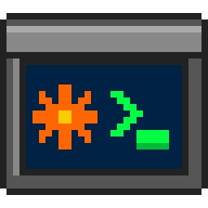
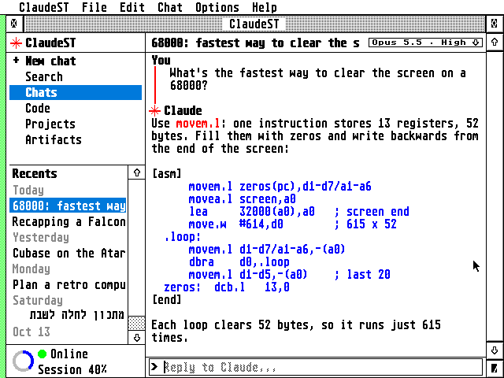

# ClaudeST



A native GEM client for [claude.ai](https://claude.ai) on the Atari ST, STE, Mega ST/STE, TT and
Falcon, through the AERA Gateway (a Raspberry Pi or any Linux computer on your network).

**Highlights**

- **Like the website:** your claude.ai chats, projects and search; replies stream in.
- **Claude Code sessions:** read them and reply.
- **Artifacts:** view them and save them to disk.
- **Attach files** of any kind, or drop them on the window.
- **Model and effort** for each chat, from a chip in the title bar.
- **Usage at a glance:** a ring that fills as you use your plan.
- **Right-click menus** to pin, rename, move to a project, archive and delete.
- **Hebrew:** right-to-left text and a Hebrew keyboard (F10).
- **Fonts:** the system font, or any fixed-width GDOS font with NVDI.
- **Any screen** from 640×200, monochrome or colour; help in EHypView or ST-Guide.



## Getting started

Download the latest `claudest-x.y.zip` from **[Releases](../../releases/latest)** and unpack it:

| File | What it is |
|---|---|
| `CLAUDEST.PRG` | the program, for every ST, STE, TT and Falcon |
| `CLAUDEST.HYP`, `CLAUDEST.REF` | the help, for EHypView or ST-Guide |
| `CLAUDEST.RSC`, `CLSTNV.RSC` | the desktop icon (`CLSTNV.RSC` for NVDI's own palette) |

1. Set up the Gateway with [AERA-Gateway](https://github.com/whomper/AERA-Gateway#getting-started) and
   your claude.ai [session key](docs/GUIDE.md#1-get-your-claudeai-session-key).
2. Copy `CLAUDEST.PRG`, `CLAUDEST.HYP` and `CLAUDEST.REF` into one folder on the Atari and run it.
3. Choose **Options ▸ Settings…** (`Ctrl+,`) and type the Gateway's address (port 2323). The status line shows *Online* with a green dot.

**Needs:** TOS 1.04 or newer, EmuTOS or MiNT; 640×200 or larger; about 370 KB free RAM; STinG with a
network (Ethernet or WiFi); a claude.ai account or an Anthropic API key.

Under TOS, put `FOLDR100.PRG` first in `AUTO`; with STinG, set `STING.CPX`'s Delay to 10 on a Falcon
or TT, 25 to 50 on an ST. [Installing](docs/GUIDE.md#installing) has every step and why.

## AERA-Gateway

An 8 MHz 68000 can't do modern HTTPS, so the AERA apps reach the internet through
[AERA-Gateway](https://github.com/whomper/AERA-Gateway#readme), a small set of services on a Raspberry Pi or
any Linux computer on your network. ClaudeST's bridge is one of them: ClaudeST reaches it over STinG, and the
bridge talks to claude.ai for it ([how](docs/GUIDE.md#how-it-reaches-claudeai)).

## Building

```sh
sudo apt install gcc-m68k-linux-gnu python3 zip   # Debian/Ubuntu; no MiNTLib needed
make                         # binary/CLAUDEST.PRG
make test                    # the bridge's tests and the right-to-left layout's
make help HCP=/path/to/hcp   # binary/CLAUDEST.HYP and .REF (common/tools/build-hcp.sh DIR builds hcp)
make dist                    # dist/claudest-x.y.zip and each file, as on the Releases page
```

A release: `tools/bump.py`, push, then **Actions > Release > Run workflow**. [More](docs/GUIDE.md#building).

## Source

```
st/        the Atari program (claudest.c)
help/      the help (CLAUDEST.STG)
gateway/   a copy of AERA-Gateway's, with ClaudeST's bridge in claude-st/
common/    the AERA programs' shared code, a copy of AERA-Atari's
docs/      the user guide (GUIDE.md); the rest is in its Source layout
```

## Tests

`make test` runs the bridge's tests and the right-to-left layout's; the Hatari rigs are in the
[guide](docs/GUIDE.md#the-hatari-rigs).

## Licence

ClaudeST is free software: you can redistribute it and/or modify it under the terms of the GNU General
Public License as published by the Free Software Foundation, either version 2 of the License, or (at
your option) any later version. It is distributed in the hope that it will be useful, but WITHOUT ANY
WARRANTY; without even the implied warranty of MERCHANTABILITY or FITNESS FOR A PARTICULAR PURPOSE. See
[COPYING](COPYING).

Copyright (C) 2026 AERA | Erez Yaary.

Not affiliated with Anthropic or Atari; Claude is a trademark of Anthropic PBC, Atari of Atari
Interactive. `common/` also carries [BearSSL](common/third_party/bearssl) (MIT) for the other apps.

---

Part of **AERA** for Atari: [ECal](https://github.com/whomper/ECal) · [EContact](https://github.com/whomper/EContact) · [EMail](https://github.com/whomper/EMail) · [EFTP](https://github.com/whomper/EFTP) · [EHypView](https://github.com/whomper/EHypView) · [ClaudeST](https://github.com/whomper/ClaudeST) · [EWeb](https://github.com/whomper/EWeb) · [EUpdate](https://github.com/whomper/EUpdate) · [EPDF](https://github.com/whomper/EPDF) · 8-bit: [EDOS](https://github.com/whomper/EDOS) · [EFTP_XL](https://github.com/whomper/EFTP_XL) · Gateway: [AERA-Gateway](https://github.com/whomper/AERA-Gateway)
