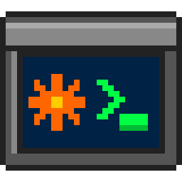

# ClaudeST



A native GEM client for [claude.ai](https://claude.ai) on the Atari ST, STE, Mega ST/STE, TT and
Falcon, through a Raspberry Pi bridge.

**Highlights**

- **Like the website:** chats, Search, Code, Projects and Artifacts on the left, the open conversation
  on the right, and replies streaming in as Claude writes them.
- **Your real claude.ai account:** recent and pinned chats, projects, search.
- **Claude Code sessions:** read them and reply.
- **Artifacts:** view them and save them to disk, Word documents included.
- **Attach files** of any kind to a message, as on the website: from the file selector or dropped on
  the window.
- **Model and effort** for each chat, from a chip in the title bar.
- **Right-click menus** to pin, rename, move to a project, archive and delete.
- **Usage at a glance:** a ring that fills as you use up the current session, and an Account page
  with your plan and usage.
- **Hebrew:** right-to-left text and a Hebrew keyboard layout.
- **Fonts:** a font selector (**Options ▸ Font…**), as in EMail and ECal: the system font in two
  sizes, or any fixed-width GDOS font with NVDI.
- **Any screen** from 640×200, monochrome or colour.

The [user guide](docs/GUIDE.md) describes every feature.


## Getting started

ClaudeST has two parts: the bridge, on a Raspberry Pi or any Linux computer on your network, and the
program on the Atari. Set up the Pi first.

Give the Pi a fixed IP address, for example with a DHCP reservation in your router, so that ClaudeST
always finds it. Give the Atari one too, unless you let the bridge accept any address on your network
(`--atari any`, below). The examples below use **192.168.1.10** for the Pi and **192.168.1.20** for the
Atari. Replace them with your own.

### 1. Get your claude.ai session key

1. Log in to claude.ai in a desktop browser.
2. Open the developer tools (F12). Go to **Application** (Chrome) or **Storage** (Firefox), then
   **Cookies**, then `https://claude.ai`.
3. Copy the value of the `sessionKey` cookie. It starts with `sk-ant-sid`.

The key gives full access to your account. It is stored only on the Pi, readable only by root and the
bridge.

### 2. Install the bridge on the Pi

The Pi side of all the AERA apps is installed by
[AERA-Gateway](https://github.com/whomper/AERA-Gateway). It always installs the bridge from ClaudeST's
[latest release](https://github.com/whomper/ClaudeST/releases/latest), never unreleased code (its
README's [Getting started](https://github.com/whomper/AERA-Gateway#getting-started) has the details).
In your home folder on the Pi:

```sh
sudo apt install -y git      # Raspberry Pi OS Lite only: it comes without git
git clone https://github.com/whomper/AERA-Gateway.git
cd AERA-Gateway
./update-pi.sh
sudo gateway/aera-gateway install claude --network --atari 192.168.1.20
```

Put the Atari's address in place of `192.168.1.20`. The installer asks for the session key. It then runs the bridge as a service called `claude-st`, which
starts at every boot and accepts connections only from the Atari's address. Use `--atari IP1,IP2` for
several Ataris, or `--atari any` to accept any address on your network. If the `ufw` firewall is on,
the installer opens port 2323 for them.

Or the short way, which sets up every AERA gateway on the Pi in one line, ClaudeST's bridge among
them (over the network, for the Atari's address):

```sh
sudo apt install -y git && git clone https://github.com/whomper/AERA-Gateway ~/AERA-Gateway && ~/AERA-Gateway/update-pi.sh --allow 192.168.1.20
```

It also installs the gateways of ECal and EContact, EFTP and EWeb, which do nothing until those apps
use them; for the bridge alone, use the steps above. `update-pi.sh` makes `aera-gateway` a command, so
from then on `sudo aera-gateway` works in any folder.

### 3. Set up the Atari

The [latest release](https://github.com/whomper/ClaudeST/releases/latest) has these files, each on its
own and all together in `CLAUDEST-x.y.zip` (the icon files in its `icons/` folder):

| File | What it is |
|---|---|
| `CLAUDEST.PRG` | the program |
| `CLAUDEST.HYP`, `CLAUDEST.REF` | the help, for EHypView or ST-Guide: keep them next to `CLAUDEST.PRG`, and press Help in ClaudeST |
| `CLAUDEST.RSC` | the desktop icon: black-and-white, and in 16 and 256 colours. Take it under TOS, EmuTOS, or NVDI with COLORVDI |
| `CLSTNV.RSC` | the same for NVDI with its own palette, whose 256 colours differ from TOS's |
| `CLAUDEST.ICN`, `CLAUDSMK.ICN` | the black-and-white icon and its mask, for icon editors |

1. Load **STinG** and check that the network works, for example by pinging the Pi.
2. Copy `CLAUDEST.PRG`, `CLAUDEST.HYP` and `CLAUDEST.REF` into one folder, any folder on any drive.
3. Run `CLAUDEST.PRG`, choose **Options ▸ Settings…** (`Ctrl+,`), pick **Network** and type the Pi's
   address (port 2323). Or type `/connect 192.168.1.10` in the reply line. The status line at the
   bottom left shows *Connecting…*, then *Online*, with a green dot.

ClaudeST keeps what you set in `CLAUDEST.INF`, which it writes next to the program. If the Pi
restarts or the network drops, ClaudeST reconnects by itself. The guide's [Icons](docs/GUIDE.md#icons) section says how to put the icon on the
desktop.

### Updating

- **The Atari:** from a new release, copy `CLAUDEST.PRG`, `CLAUDEST.HYP` and `CLAUDEST.REF` over the old
  ones. Your settings, in `CLAUDEST.INF`, stay as they are.
- **The Pi:** when a release's notes say the bridge changed, run `cd ~/AERA-Gateway && ./update-pi.sh`
  (see [Looking after the Pi](#looking-after-the-pi)). It is safe to run at any time.
  `gateway/aera-gateway status` in the same folder shows what runs and which ClaudeST release.

### Using a serial cable instead

Connect the Atari's Modem port to a USB-to-RS-232 adapter on the Pi with a null-modem cable. Don't wire
the Atari straight to the Pi's GPIO pins: the Atari's ±12 V signals damage the Pi. Then, on the Pi:

```sh
sudo gateway/aera-gateway install claude --serial auto
```

On the Atari, choose **Options ▸ Settings…** and pick **Serial** (a new ClaudeST, with nothing set
yet, starts on the serial port). Both sides use 19200 baud
by default. The guide's [Serial cables and ports](docs/GUIDE.md#serial-cables-and-ports) says which
port to use on each Atari.

### Using the Anthropic API instead of claude.ai

Run the installer again with `--backend api` (or add it in step 2):

```sh
sudo gateway/aera-gateway install claude --backend api
```

The installer asks for an API key. Chats are then stored on the Pi, in `/var/lib/claude-st/chats/`,
instead of in your claude.ai account. `--backend demo` gives sample chats without any account, to test
the setup.

**Needs:** an ST, STE, Mega ST/STE, TT or Falcon with TOS 1.04 or newer, EmuTOS or MiNT; a 640×200 or
larger screen; about 370 KB of free RAM (ClaudeST makes do with 260 KB, keeping less of a long chat); STinG with a working network, or a null-modem serial cable; a
Raspberry Pi, or any Linux computer, on the same network; a claude.ai account, or an Anthropic API key.

**Under TOS, put Atari's `FOLDR100.PRG` first in `AUTO`**, renamed for more room (`FOLDR400.PRG`).
TOS keeps an entry in a small internal pool for every folder a program or accessory has looked
into, and halts with "OUT OF INTERNAL MEMORY" when it runs out; FOLDRxxx makes the pool bigger.

**With STinG, set the Delay in `STING.CPX` to suit the machine:** 10 on a Falcon or TT, 25 to 50 on
an ST, as STinG's manual says. STinG looks at the network card that often, so it sets the speed of
every STinG program: on a Falcon with a NetUSBee, Delay 10 took EFTP's downloads from 40 to 75 KB/s.

## How it reaches the servers

An 8 MHz 68000 can't do modern HTTPS, so a small Python program, the bridge, does it for the Atari. It
runs on a Raspberry Pi or any Linux computer on your network:

```
STinG:   Atari (CLAUDEST.PRG) --plain TCP, home LAN, port 2323--> Raspberry Pi (bridge) --HTTPS--> claude.ai
Serial:  Atari (CLAUDEST.PRG) --null-modem cable, 19200 baud----> Raspberry Pi (bridge) --HTTPS--> claude.ai
```

- **Through STinG,** over Ethernet or WiFi, the Atari connects to the bridge's port 2323. The bridge
  accepts only the addresses you gave the installer with `--atari`.
- **Through a serial cable,** the Atari's Modem port goes to a USB-to-RS-232 adapter on the Pi.
- **The bridge** talks to claude.ai (or the Anthropic API) and sends the Atari short lines of text in
  the Atari character set. The Atari does all the drawing and word wrapping itself.

The bridge is in [`bridge/`](bridge/), its installer and service in [`pi/`](pi/). To run it without
the installer, on macOS or Windows too, see the guide's
[The bridge on another computer](docs/GUIDE.md#the-bridge-on-another-computer).

## Looking after the Pi

Run these in the `AERA-Gateway` folder:

| Task | Command |
|---|---|
| Update to the latest releases | `./update-pi.sh` |
| Paste a new session key, when claude.ai logs you out | `sudo gateway/aera-gateway set-key` |
| Change the Atari's address | `sudo gateway/aera-gateway install claude --atari 192.168.1.21` |
| See what runs, and which ClaudeST release | `gateway/aera-gateway status` |
| Watch the bridge's log | `journalctl -u claude-st -f` |
| Remove it | `sudo gateway/aera-gateway remove claude` |

`update-pi.sh` brings AERA-Gateway to its latest release and the bridge to ClaudeST's latest release,
keeping every setting. The same installer sets up EMail's, ECal's and EFTP's gateways on the same Pi.
The settings are in `/etc/claude-st/claude-st.env`. If claude.ai can't be reached or the session key
has expired, the error appears on the Atari.

A Pi set up earlier with ClaudeST's `pi/install.sh` is taken over as it is: clone AERA-Gateway and run
`./update-pi.sh`. `pi/install.sh` still works, and now also installs the bridge from the latest
release.

## Keys

| Key | Does |
|---|---|
| F1 / ^N | New chat |
| F2, F6, F3, F4 | Chats, Code, Projects, Artifacts |
| F5 / ^F | Search chat titles |
| Tab, then Return | Pick and open a sidebar item |
| Insert, or right-click | The item's menu |
| F8, or click the status line | Account: plan, usage and details |
| F9, or click the model chip | Model and effort |
| F10 | Hebrew keyboard on or off |
| ^O | Attach a file to the next message (Backspace on the empty reply line removes the last one) |
| ^, | Settings: the gateway's address and port, or the serial port |
| Undo | Cancel any dialog or alert |
| Esc | Empty the box with the cursor in a dialog (in Search, the search); cancel an alert or a dialog without a box. Never empties the reply line |
| Shift+Delete | Clear the reply line (^X cuts it to the clipboard) |
| Help | Help in EHypView or ST-Guide, or the keys (also in the Help menu) |
| ^U, ^Q | Close the window, quit (ClaudeST has one window: ^W does nothing) |

The guide has [all the keys](docs/GUIDE.md#all-keys).

## Good to know

ClaudeST is an unofficial client, not affiliated with Anthropic or Atari. claude.ai has no public API
for personal accounts, so the bridge uses the same private interface as the claude.ai website. If
claude.ai changes it, parts can stop working until the bridge is updated. The guide's
[Troubleshooting](docs/GUIDE.md#troubleshooting) section has commands that check each part from the Pi.

With claude.ai, your chats stay on claude.ai: the bridge fetches them each time and doesn't store them.
The Pi keeps only your session key, the bridge's settings and the effort you chose for each chat. The
guide lists [what is stored where](docs/GUIDE.md#what-is-stored-where).

ClaudeST was first called Claude ST, then EClaude for a few days. To upgrade, replace `CLAUDE.PRG` or
`ECLAUDE.PRG` with `CLAUDEST.PRG`: your settings in `CLAUDE.INF` or `ECLAUDE.INF` are read the first
time, then saved as `CLAUDEST.INF`. The Raspberry Pi side keeps its service name, `claude-st`.

ClaudeST was written with Claude, in Claude Code on claude.ai: a claude.ai client for the Atari, built
by talking to claude.ai.

## Building

```sh
sudo apt install gcc-m68k-linux-gnu python3 zip   # Debian/Ubuntu; no MiNTLib needed
make                         # binary/CLAUDEST.PRG
make test                    # the bridge's tests and the right-to-left layout's, on this computer
make help HCP=/path/to/hcp   # binary/CLAUDEST.HYP and .REF (common/tools/build-hcp.sh DIR builds hcp)
make dist                    # dist/CLAUDEST-x.y.zip and each file, as on the Releases page
```

`binary/` and `dist/` are what make builds; they are never committed, and a build changes no tracked
file. The version is `VERSION` in `st/claudest.c`: the last release, which every build shows in the About
box. A release: `tools/bump.py`, commit
and push, then **Actions > Release > Run workflow** on `main` with what is new. The workflow tests,
builds, tags the commit `vX.Y` and publishes each file and the zip on the Releases
page. Pushing a tag `vX.Y` made with `git tag -a` does the same, with the tag's message as the notes.

The guide's [Building](docs/GUIDE.md#building) section has more: the shared code, other toolchains,
running ClaudeST in Hatari, recording the demo video and retaking the screenshots.

## Source

```
st/        the Atari program: claudest.c (UI and protocol), bidi_test.c
help/      CLAUDEST.STG, the ST-Guide help (make help)
bridge/    claude_bridge.py (links and protocol), backends.py (claude.ai, API, demo),
           atari_text.py (charset and Markdown), test_bridge.py
pi/        install.sh (hands on to gateway/aera-gateway) and the systemd service
gateway/   the AERA gateways for the Pi and aera-gateway, their installer, which sets up the
           bridge: a copy of AERA-Gateway's (tools/sync-gateway.sh)
common/    the AERA programs' shared code, a git subtree of AERA-Atari: start-up, C library,
           TOS, AES/VDI, STinG, the right-to-left layout, elf2tos.py
tools/     hatari-test.sh, sync-common.sh, sync-gateway.sh, bump.py, check_version.sh,
           docshots.py (the screenshots), icon/ (the desktop icon), reel/ (the demo video)
tests/     hatari/: disk_budget.sh (the disk-access check), font_gdos.py (a GDOS font) and
           long_field.sh (a name longer than its box)
icons/     the desktop icon files (make icons, from common/icons/CLAUDEST.txt)
docs/      the user guide (GUIDE.md), its screenshots, the demo recording and the help's front
           page (front.json, help/WINDOW.IMG: help/Makefile adds it with common/tools/helpfront.py)
```

The program is freestanding C with its own start-up code and AES, VDI and STinG bindings, so it needs
no MiNTLib and no resource file. Change `common/` in [AERA-Atari](https://github.com/whomper/AERA-Atari),
never here, then bring the copy up to date with `tools/sync-common.sh`.
[PROTOCOL.md](PROTOCOL.md) describes the line protocol between the Atari and the bridge.

## Tests

`make test` runs, on this computer:

- **the bridge's tests** (`bridge/test_bridge.py`): the Atari character set, Markdown, and the protocol
  against the demo backend and stubbed claude.ai answers, with no account or network needed;
- **the right-to-left layout's test** (`st/bidi_test.c`, with `common/src/bidi.c`).

The CI workflow runs them, and builds the program, on every push to `main` and every pull request.

To try ClaudeST itself, `tools/hatari-test.sh` boots [Hatari](https://hatari.tuxfamily.org/) into it,
with EmuTOS 1.4 (downloaded the first time, or your own TOS images in `~/.aera/tos`) and the bridge
on this computer, connected through the emulated serial port:

```sh
tools/hatari-test.sh                 # demo chats, no account needed
CLAUDE_SESSION_KEY='sk-ant-sid01-...' tools/hatari-test.sh claudeai
MACHINE=Falcon tools/hatari-test.sh  # ST (the default), ST-1, TT or Falcon; ST:med for colour
LINK=network tools/hatari-test.sh    # over STinG instead of the serial cable
```

Hatari has no network card: with `LINK=network`, the shared `FAKESTNG.PRG` (`common/tools/fakesting`,
built by the script) stands in for STinG by tunnelling its TCP connections over the serial port to the
bridge on TCP port 2323, as on the Pi, to test the network code. It is for the emulator only; never
install it on a real Atari. The guide's [Running it in Hatari](docs/GUIDE.md#running-it-in-hatari) has more.

`tests/hatari/disk_budget.sh` checks ClaudeST's disk work in Hatari against the AERA rule (the
guidelines, 6.5), from Hatari's GEMDOS trace. It fails if a conversation or an idle window touches the
disk at all, or if saving a 50 KB artifact or attaching a 40 KB file takes more than one open and a
few big reads or writes (`MACHINE=ST-1` or `TT` for the other machines).

`tests/hatari/font_gdos.py WORK` chooses the first fixed-width GDOS font in Options ▸ Font and checks
that the window redraws in it with no dialog left, that `CLAUDEST.INF` keeps it, and that a Hebrew
chat draws the same after a restart. It needs GDOS fonts (NVDI: `AERA_WITH_NVDI=1` on the Falcons,
see `common/tools/machines.py`) and skips without them; `--release v1.49` tests a release.

`tests/hatari/long_field.sh` types a 62-character name into Rename, whose box shows 43, going to the
start and the end of it with `Shift+←` and `Shift+→`, and checks that the bridge gets all of it (the
guidelines, 5.4; `MACHINE=` as above).

## Licence

ClaudeST (the Atari program, the bridge and the Pi's setup) is free software: you can redistribute it
and/or modify it under the terms of the GNU General Public License as published by the Free Software
Foundation, either version 2 of the License, or (at your option) any later version. It is distributed
in the hope that it will be useful, but WITHOUT ANY WARRANTY; without even the implied warranty of
MERCHANTABILITY or FITNESS FOR A PARTICULAR PURPOSE. See [COPYING](COPYING).

Copyright (C) 2026 AERA | Erez Yaary.

ClaudeST is an unofficial client, not affiliated with Anthropic or Atari; Claude is a trademark of
Anthropic PBC, Atari a trademark of Atari Interactive.

The shared `common/` folder also carries, for the other AERA programs, [BearSSL](common/third_party/bearssl)
by Thomas Pornin (MIT licence) and Mozilla's root certificates (Mozilla Public License 2.0); ClaudeST
doesn't use them.

---

Part of **AERA** for Atari: [ECal](https://github.com/whomper/ECal) · [EContact](https://github.com/whomper/EContact) · [EMail](https://github.com/whomper/EMail) · [EFTP](https://github.com/whomper/EFTP) · [EHypView](https://github.com/whomper/EHypView) · [ClaudeST](https://github.com/whomper/ClaudeST) · [EWeb](https://github.com/whomper/EWeb) · [EUpdate](https://github.com/whomper/EUpdate) · 8-bit: [EDOS](https://github.com/whomper/EDOS) · [EFTP_XL](https://github.com/whomper/EFTP_XL) · Pi: [AERA-Gateway](https://github.com/whomper/AERA-Gateway)
