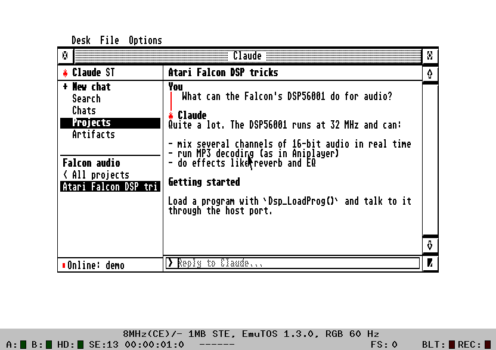

# ClaudeST user guide

The [README](../README.md) covers setup. This guide describes each part
of ClaudeST, then troubleshooting, settings and building. The
screenshots use the bridge's demo backend, so they show sample chats.

- [The window](#the-window)
- [Chats, projects and search](#chats-projects-and-search)
- [Right-click menus](#right-click-menus)
- [Model and effort](#model-and-effort)
- [Code: Claude Code sessions](#code-claude-code-sessions)
- [Artifacts](#artifacts)
- [Account, plan and usage](#account-plan-and-usage)
- [Hebrew](#hebrew)
- [All keys](#all-keys)
- [Settings (CLAUDEST.INF)](#settings-claudestinf)
- [What is stored where](#what-is-stored-where)
- [Troubleshooting](#troubleshooting)
- [The bridge on another computer](#the-bridge-on-another-computer)
- [Serial cables and ports](#serial-cables-and-ports)
- [Icons](#icons)
- [Building](#building)

## The window

The sidebar on the left has **+ New chat**, **Search**, **Chats**,
**Code**, **Projects** and **Artifacts**, then the list for the chosen
area. The open conversation fills the right side, with the reply line at
the bottom. Drag the divider between them to resize the sidebar; the
pointer turns into a hand over it.

Where the AES can iconify windows (MultiTOS, MagiC, XaAES, N.AES), the
window has the iconify button: ClaudeST shrinks to its icon, with *busy*
under it while Claude answers and *offline* when the bridge isn't there.
Replies still come in while it is iconified.



- **Status area** (bottom left): a dot for the connection, green when
  online and red when not (filled or hollow in black and white), with
  *Connecting…*, *Online* or *Offline: …* beside it. With claude.ai, a
  ring next to it fills clockwise as you use up the current session
  (claude.ai's 5-hour limit): blue, turning red from 90%, on a grey track
  in 16 colours; black on a dotted grey track with fewer colours. Below, *Session
  30%* and, when the sidebar is wide enough, the time until it resets.
  The bridge checks after each reply, and at most every two minutes
  otherwise. Click the area for the full Account page.
- **Notices:** short messages such as *Loading chat...* or *Renamed*
  appear in grey at the right of the title bar for a few seconds.
- **Tooltips:** rest the mouse on a name that's cut off, in the sidebar
  or the title bar, and a tooltip shows all of it.


- **Switching area** empties the list at once, showing *Loading...* or
  the bridge's progress until the new list arrives. It also clears the
  conversation pane, so what you type next starts a new chat.
- **Scrolling:** the scroll bar, `↑` `↓`, `Shift+↑/↓` by page, and
  `Clr/Home` / `Shift+Clr/Home` for the top and bottom.

## Chats, projects and search

- **Chats** lists your recent chats under date headings, as on claude.ai:
  **Pinned** first (pinned chats also show a small diamond), then
  **Today**, **Yesterday**, a date such as **Oct 4** for each of the
  last seven days, and **Older** for the rest. Project chats, search
  results and Code sessions are grouped the same way. The headings can't
  be clicked, and `Tab` skips them.
- **Unread chats** have a small dot to the left of their name (blue in
  16 colours): a reply came in since you last read the chat, on
  claude.ai or on the Atari, for example one that finished on the
  website or in the background. Opening it removes the dot. claude.ai
  keeps no read time for older chats, so those never get a dot. Reading a
  chat on the Atari doesn't mark it read on claude.ai.
- **Projects** lists your projects. Opening one lists its chats, with
  **< All projects** at the top. A new chat started there is created in
  that project.
- **Search** (`F5`) empties the list and turns the reply line into
  *Find:*. Type words from a chat's title and press `Return`.

A long conversation shows its last 40 messages.

## Right-click menus

Right-click an item, or pick it with `Tab` and press `Insert`. The item
is highlighted while its menu is open.

| Item | Menu |
|------|------|
| Chat | Open, Pin/Unpin, Rename…, Move to project…, Delete… |
| Project | Open, Pin/Unpin, Rename…, Archive, Delete… |
| Code session | Open, Rename…, Archive |
| Artifact | Open, Save to disk… |


**Move to project…** lists your projects, with **New project…** at the
top, above a line. **New project…** asks for a name, creates the project
and moves the chat into it.


**Rename…** opens a dialog with the current name: edit it and press
`Return`, or `Esc` to cancel. **Delete…** always asks first. In menus,
the arrow keys and `Return` work too, and `Esc` closes them.

## Model and effort

The chip at the right of the title bar shows the open chat's model and
effort, such as **Opus 5.5 · Med**. Click it, or press `F9`, for the
menu: the models, then the effort levels that model supports.


- **Models offered:** Opus 5.5, Fable 5.1, Sonnet 5.5, Haiku 4.5, Opus 5
  and Opus 4.8. A chat on an older model, such as Sonnet 4, adds that
  model to the menu.
- **Effort:** Low, Medium, High, Extra high and Max. Higher effort means
  more thinking: slower and more thorough. The default is Medium for
  Opus 5.5 and High for the others. Haiku and models older than the 4.5
  family have no effort setting; Opus 4.5 has only Low, Medium and High.
- **Each chat keeps its own model and effort.** Opening a chat, a
  project's chat or a Code session shows the model and effort claude.ai
  has for it. If claude.ai has no effort for it, the chip shows the one
  you last chose for that chat, or else the model's default. Changing
  them changes that chat, and also becomes the choice for new chats,
  which is saved in `CLAUDEST.INF`.
- **claude.ai:** new chats start on **Default model**, your account's
  own choice, until you pick one. A chat's effort is read from, and
  saved to, the chat's own settings on claude.ai, so the website shows
  the same. The Pi also remembers the effort you choose for each chat
  and Code session, in `/var/lib/claude-st/chat-effort.json` (the 500
  most recent), for chats where claude.ai doesn't report one.
- **API backend:** the model and effort go with every request and are
  stored with each chat.

## Code: Claude Code sessions

**Code** (`F6`) lists your Claude Code sessions from claude.ai/code,
newest first.


- **Reading:** your messages and Claude's replies, with each tool call
  as a one-line note such as `[Bash: make -C st]`. Tool output is left
  out.
- **Replying:** what you type goes to the open session, and Claude
  Code's replies appear as it works. If it's still working after 15
  minutes, ClaudeST stops waiting; open the session again later to see
  the rest.
- **Model:** the chip shows the session's own model. Changing it asks
  claude.ai to switch that session, without changing the model for your
  new chats.

## Artifacts

**Artifacts** (`F4`) lists the artifacts in your 40 most recent chats,
newest first: by when Claude last updated each one, then by when it was
created, under date headings like the chat list. claude.ai keeps
artifacts inside chats, so the bridge looks through them; the list shows
*Scanning chat 12/40* meanwhile. The
bridge keeps what it found in memory, so the next time only new or
changed chats are scanned. Artifacts from chats you delete, or that are
no longer among the 40 most recent, leave the list the next time it
loads.

It finds artifacts in every form claude.ai has used, including files
Claude made with a script, such as a Word cover letter.

- **Open** shows the source. A Word document shows its text.
- **Save to disk…** opens the GEM file selector with an 8.3 name such as
  `SNAKE_GA.PY` or `COVER_LE.DOC`. A file Claude made with a script, such
  as a Word document, is downloaded from claude.ai when you open or save
  it, and not kept on the Pi afterwards. Text is saved in the Atari character
  set with CR/LF line ends. Word, PDF and other binary files are saved
  unchanged.

To look further back than 100 chats, see
[extra bridge options](#extra-bridge-options).

## Account, plan and usage

Press `F8`, click the status line, or choose **Options ▸ Account…**.


- **Plan:** Free, Pro, Max (5x or 20x usage), Team or Enterprise.
- **Usage:** a meter for each limit, as on claude.ai's Usage page: the
  current 5-hour session, this week's usage, and any included cloud
  session credit, each with when it resets or expires, in the Pi's time
  zone.
- **Account:** your name, email, organization and the date you joined.

With the API backend, the page shows the tokens used since the bridge
started instead.

## From other programs

A text file handed to ClaudeST while it runs, by a desktop such as
Thing, jinnee or Gemini (or any program, with the AV protocol's
VA_START), goes into the reply line at the cursor, its lines joined by
spaces, as much as fits (1000 characters). Other files are refused.
Under MultiTOS, MagiC or XaAES you can drag a text file onto the window
too, or text from another program: it goes into the reply line the same
way.

## Copy and paste

Edit > Cut, Copy and Paste (`Ctrl+X`, `Ctrl+C`, `Ctrl+V`) use the GEM
clipboard, which other programs share:

- **`Ctrl+V`** puts the clipboard's text into the reply line at the
  cursor, its lines joined by spaces.
- **`Ctrl+C`** copies the reply line, and **`Ctrl+X`** cuts it.
- **With the reply line empty,** `Ctrl+C` copies Claude's last answer, a
  line for each paragraph, ready to paste into EMail or a text editor.
  **Edit > Copy Claude's answer** does the same.
- **In the rename and new project boxes,** the same keys work on the name.

## Hebrew

TOS has no right-to-left text support, so ClaudeST lays it out itself.
A paragraph that starts in Hebrew is right-aligned and reads right to
left, with English words and numbers inside it kept in order. The same
applies to titles in the sidebar and the title bar, and to the reply
line.


**Typing Hebrew:** press `F10`, or choose **Options ▸ Hebrew keys**. The
letter keys then type Hebrew in the Israeli SI-1452 layout, and an
**HE** badge shows in the reply box. Shift still types English capitals.
Keys are mapped by position, so any national Atari keyboard works.

The Atari font has only the plain letters, so the bridge drops vowel
points (niqqud) and turns maqaf, geresh and gershayim into `-`, `'` and
`"`.

## Font

**Options ▸ Font…** opens a font selector like EMail's and ECal's, and
like other GEM programs': the font families on the left, the sizes of
the chosen one beside them, what kind of font it is (bitmap, Speedo,
TrueType, Type 1) and a sample below. The chosen font is used for
everything in ClaudeST's window: the sidebar, the title bar, the
conversation and the reply line. Menus and the font selector itself
keep the system font.

- **The system font** comes in two sizes, 8×8 and 8×16. 8×8 fits twice
  as many lines on an ST high or a Falcon VGA screen.
- **GDOS fonts:** with a GDOS such as NVDI or SpeedoGDOS, its fonts are
  listed too. ClaudeST lays text out in character cells, so it needs a
  fixed-width font: proportional ones are listed in grey and can't be
  picked. The first time, ClaudeST measures each font to find them
  ("Looking for fixed-width fonts" on the status line; it can take a
  while with many vector fonts) and keeps the answers in `CLAUDEST.FNT`,
  so the selector opens quickly afterwards and only new fonts are
  measured. Delete `CLAUDEST.FNT` to measure them all again.
- **Hebrew letters:** fonts keep them in different places: the standard
  Atari font (TOS, EmuTOS) at the Atari character set's, Israeli system
  fonts and many GDOS fonts where ISO-8859-8 or DOS 862 put them. If
  Hebrew shows as other symbols, open Options ▸ Font: the three buttons
  under "Hebrew in bitmap fonts" each show the word shalom as that kind
  of font would; pick the one that reads correctly, and the sample below
  shows the result. A vector font (Speedo, TrueType, Type 1) is asked
  through NVDI 5 for its Hebrew letters by Unicode, as FreeMono and
  Liberation Mono have them; the Type line then says "Hebrew from the
  font". A vector font without Hebrew, or without NVDI 5 to ask, says
  "Hebrew in the system font": those letters are then drawn in the
  system font, in the same cells.

Keys in the selector: `↑` `↓` change the family, `←` `→` the size,
`Return` is OK and `Esc` cancels. A double click on a family or size
also picks it.

## Help

`CLAUDEST.HYP` is a short hypertext of this guide: setup, every part of
the window, the keys, the settings and troubleshooting. Keep it next to
`CLAUDEST.PRG` (or in the viewer's help folder); with EHypView, ST-Guide
or HypView running (as an accessory, or as a program under MultiTOS or
MagiC), `Help` in ClaudeST opens it. Without a viewer, `Help` says how to
get one and offers the About box instead. It also opens on its own in any
of them.

## All keys

| Key | Does |
|-----|------|
| `F1` / `Ctrl+N` | New chat |
| `F2` | Chats |
| `F3` | Projects |
| `F4` | Artifacts |
| `F5` / `Ctrl+F` | Search chat titles |
| `F6` | Code |
| `F8` | Account |
| `F9` | Model and effort |
| `F10` | Hebrew keyboard on or off |
| `Tab` / `Shift+Tab`, `Return` | Pick and open a sidebar item |
| `Insert` | The picked item's menu |
| `←` `→`, `Shift+←/→`, `Ctrl+←/→` | Move in the reply line: by character, to the start or end, by word |
| `Esc` / `Undo` | Clear the reply line |
| `Ctrl+R` | Reconnect to the bridge |
| `Ctrl+C`, `Ctrl+X`, `Ctrl+V` | Copy, cut, paste the reply line (`Ctrl+C` with it empty: Claude's last answer) |
| `Help` | This help (`CLAUDEST.HYP`) in EHypView, ST-Guide or HypView (without one: how to get one, or the About box) |
| `Ctrl+Q`, `Ctrl+W` | Quit (Ctrl+W closes the window, ClaudeST's only one) |

In the reply line, `/connect 192.168.1.10` (or `/connect host:port`)
sets the gateway address, and `/serial` switches to the serial port.

## Settings (CLAUDEST.INF)

ClaudeST saves its settings to `CLAUDEST.INF`, next to `CLAUDEST.PRG`, as
soon as you change them. You can also edit it in any text editor.

| Line | Set by |
|------|--------|
| `tcp 192.168.1.10 2323`, or `serial` | `/connect`, `/serial`, Options ▸ Network / Serial port |
| `baud 19200` (or 9600, 4800) | Options ▸ baud rate |
| `sidebar 240` | dragging the divider (width in pixels) |
| `keyboard hebrew` | `F10` / Options ▸ Hebrew keys |
| `port 7` | edit by hand: on a TT or Falcon, which serial port to use: 6 = MFP (TT Modem 1), 7 = SCC B (Modem 2, the Falcon's Modem port), 8 = TT-MFP (Serial 1), 9 = SCC A (Serial 2). Without it, ClaudeST uses the port TOS has chosen. |
| `model claude-sonnet-5-5 max` | the model chip / `F9` |
| `font 1 8 0` | Options ▸ Font: the font's id (1 = the system font), its size in points (8 or 16 for the system font's two sizes) and where it keeps Hebrew (0 Atari, 1 ISO-8859-8, 2 DOS 862) |

Lines starting with `;` are comments. The window always opens full
screen with a new chat.

## What is stored where

| Where | What |
|-------|------|
| claude.ai | Your chats, projects, artifacts and Code sessions. The bridge fetches them each time you open them; with claude.ai, no chat is stored on the Pi. |
| Pi: `/etc/claude-st/claude-st.env` | The session key (or API key) and the bridge's options, readable only by root and the bridge |
| Pi: `/var/lib/claude-st/chat-effort.json` | The effort you chose for each chat and Code session |
| Pi: `/var/lib/claude-st/chats/` | Only with the API backend: your chats, one file each |
| Pi: the bridge's memory | The artifacts found in your recent chats, to load the list quickly; gone when the bridge restarts |
| Pi: the log (`journalctl -u claude-st`) | Connections, errors, model changes and usage figures; not what you or Claude write |
| Atari: `CLAUDEST.INF` | ClaudeST's settings |
| Atari: `CLAUDEST.FNT` | Which GDOS fonts are fixed-width, so the font selector needn't measure them again |
| Atari: `CRASH.LOG` | What happened, if ClaudeST ever crashed (next to `CLAUDEST.PRG`) |

The open conversation lives only in the Atari's memory while ClaudeST
runs.

## Troubleshooting

All commands run on the Pi.

| Problem | What to do |
|---------|-----------|
| *Connecting…* never turns into *Online* | Check `systemctl status claude-st`, the address in `CLAUDEST.INF`, and that the Atari's address matches the installer's `--atari` |
| "claude.ai has moved this chat to its new chat system, and ClaudeST could not open its new part" | claude.ai moves some chats to its newer chat system. ClaudeST normally continues them there, but this time claude.ai refused. `run --probe-chat CHAT_ID` (see below) shows why. Meanwhile, start a new chat, or continue that one on claude.ai |
| An error mentions the session key, or HTTP 401/403 | claude.ai logged you out: get a new key and run `sudo ./install.sh --set-key` |
| Something else fails | Watch `journalctl -u claude-st -f` while you try again on the Atari |
| ClaudeST itself crashed (on the Atari) | It says so, writes what happened to `CRASH.LOG` next to `CLAUDEST.PRG` and quits, leaving the Atari running. A crash in the system or a driver still gives the bombs; TOS keeps a record of them, and ClaudeST adds it to `CRASH.LOG` the next time it starts. Send `CRASH.LOG` to the author. Under MiNT or MagiC, which handle crashes themselves, there is none |

These commands check the claude.ai side without showing any of your
content:

```sh
# the commands below are all run as the bridge's own user
run() { sudo -u claude-st bash -c 'while IFS="=" read -r k v; do case "$k" in [A-Z]*) export "$k=$v";; esac; done < /etc/claude-st/claude-st.env; exec /opt/claude-st/venv/bin/python /opt/claude-st/bridge/claude_bridge.py "$@"' run "$@"; }

run --probe cover        # chats with "cover" in the title: where they are, their tools, files and model
run --probe-code         # whether Claude Code sessions can be listed, and the newest one's model and effort
run --probe-chat CHAT_ID # one chat's settings (not its messages), and for a moved chat, its session
```

### Extra bridge options

To give the bridge options the installer doesn't set, such as
`--artifact-scan 300` (look through 300 chats for artifacts), add them
to `/etc/claude-st/claude-st.env` on a line of their own. The installer
keeps this line when it updates.

```sh
echo 'CLAUDE_ST_EXTRA=--artifact-scan 300' | sudo tee -a /etc/claude-st/claude-st.env
sudo systemctl restart claude-st
```

## The bridge on another computer

The bridge runs on any computer with Python 3, including macOS and
Windows.

```sh
cd bridge
pip install -r requirements.txt
export CLAUDE_SESSION_KEY='sk-ant-sid01-...'
python3 claude_bridge.py --tcp 0.0.0.0:2323 --allow 192.168.1.20   # network
python3 claude_bridge.py --serial /dev/ttyUSB0                     # serial
```

`--backend api` (with `ANTHROPIC_API_KEY`) uses the Anthropic API;
chats are then stored in `~/.claude-st/`. `--backend demo` uses sample
chats. `python3 claude_bridge.py --help` lists every option.

## Serial cables and ports

| Machine | Port |
|---------|------|
| ST, STE, Mega ST/STE | the 25-pin Modem (RS-232) port |
| TT | Modem 1 |
| Falcon 030 | the 9-pin Modem port |

Use a null-modem cable and a USB-to-RS-232 adapter on the Pi. To use the
Pi's GPIO UART instead, put a MAX3232 level-shifter board in between,
turn off the serial console in `raspi-config`, and install with
`--port /dev/serial0`. The speed is 19200 baud, 8N1; change it under
**Options** and give the Pi the same `--baud`.

A WiFi modem on the serial port also works in transparent TCP mode:
point it at the Pi's port 2323, keep ClaudeST on the serial link, and
install the Pi with `--network --atari <the modem's IP>`.

## Icons

**Desk ▸ About ClaudeST…** (or `Help` > About when no hypertext viewer runs) shows the About box, with a
colour icon on screens with 16 colours or more.


The icon is original 32×32 pixel art: an SM124-style monitor with a
spark and a GEM prompt. The release has it for the desktop (in the zip, in `icons/`):

| File | What it is |
|------|-----------|
| `CLAUDEST.RSC` | a resource file with a black-and-white and a 16-colour icon |
| `CLAUDEST.ICN`, `CLAUDSMK.ICN` | the black-and-white image and its mask |

Copy the icon from `CLAUDEST.RSC` into `DESKICON.RSC` (or `DESKCICN.RSC`
for colour icons on TOS 4) with a resource editor, then install it for
`CLAUDEST.PRG` from the desktop.

## Building

You need an m68k GCC; the stock Debian/Ubuntu cross compiler works.

```sh
sudo apt install gcc-m68k-linux-gnu
make                     # -> binary/CLAUDEST.PRG (make -C st)
make test                # the bridge's tests and the right-to-left layout's, on the host
make help HCP=...        # -> binary/CLAUDEST.HYP (hcp: common/tools/build-hcp.sh)
make dist                # a release's files in dist/
```

`binary/` and `dist/` are what make builds; they are never committed.
`VERSION` in `st/claudest.c` holds the last release, which a release
build (`RELEASE=1`) shows; any other build shows `1.35-dev`. To release:
`tools/bump.py`, commit and push, then run the Release workflow
(Actions > Release > Run workflow, on main) with what is new:
`.github/workflows/release.yml` tags the commit `v1.35`, tests, builds
the program and the help, and publishes them as a GitHub Release with
those notes. Pushing a tag `v1.35` made with `git tag -a` does the same,
with the tag's message as the notes.

The program is freestanding C with its own startup code, AES, VDI and
STinG bindings, and 68000 helpers, so it needs no MiNTLib and no
resource file. That runtime, and the right-to-left layout, are shared
with the other AERA programs: they live in `common/`, a copy of
[AERA-Atari](https://github.com/whomper/AERA-Atari)'s `common/` folder.
Change them there and bring the copy up to date with
`tools/sync-common.sh`. `common/tools/elf2tos.py` turns the ELF into a
TOS program. An `m68k-atari-mint` toolchain also works:
`make CROSS=m68k-atari-mint-`.

### Running it in Hatari

```sh
tools/hatari-test.sh                 # demo chats, no account needed
CLAUDE_SESSION_KEY='sk-ant-sid01-...' tools/hatari-test.sh claudeai
MACHINE=ste tools/hatari-test.sh     # STE in colour (st, ste or tt)
```

The script downloads EmuTOS the first time, starts the bridge and boots
[Hatari](https://hatari.tuxfamily.org/) into ClaudeST, with the emulated
serial port connected to the bridge. Hatari has no network card;
`tools/fakesting/FAKESTNG.PRG` stands in for STinG by tunnelling one TCP
connection over the serial port, to test the network code. It's for the
emulator only; never install it on a real Atari.

Hatari only connects the ST-style MFP serial port to the bridge. To run
an emulated Falcon, put `serial` and `port 6` in its `CLAUDEST.INF`; a
real Falcon uses its Modem port, which needs no `port` line.

### Recording a demo video

`tools/reel/record.py` records a demo in Hatari: a Falcon in 640×480, 16
colours, boots to the EmuTOS desktop with a ClaudeST icon, opens Claude
ST, opens a chat, and types a new question. The answer comes from
`tools/reel/reel_bridge.py`, a bridge with a scripted showcase account
and a pre-written reply, so the video needs no account. It needs Linux
with Hatari, Xvfb, xdotool and ffmpeg, and EmuTOS 512K with its
`emuicon.rsc`:

```sh
tools/reel/record.py out/ --tos etos512us.img --emuicon emuicon.rsc
```

It writes `claude-st-falcon.mp4` (1280×960) and `claude-st-reel.mp4`
(1080×1920, for phones). A recording is in [docs/demo](demo/); its
chats and answer are scripted demo content. `tools/icon/add_to_emuicon.py` adds the Claude
ST icon to EmuTOS's `EMUICON.RSC`, which also works on a real Atari
running EmuTOS.

### Source layout

```
help/      CLAUDEST.STG, the ST-Guide help: make help (needs HCP) -> binary/CLAUDEST.HYP
st/        the Atari program: claudest.c (UI and protocol), bidi_test.c,
           CLAUDEST.INF (the example settings file a release carries)
common/    the AERA programs' shared code (a git subtree of AERA-Atari):
           atari/ (start-up, C library, TOS traps, AES/VDI, STinG client),
           src/bidi.c (right-to-left), tools/elf2tos.py
bridge/    claude_bridge.py (links and protocol), backends.py (claude.ai,
           API, demo), atari_text.py (charset and Markdown), test_bridge.py
pi/        install.sh and the systemd service
tools/     hatari-test.sh, sync-common.sh, bump.py, check_version.sh,
           fakesting/, icon/
icons/     the desktop icon files (from tools/icon)
binary/    what make builds for the Atari (not committed: the releases
           have it)
```

[PROTOCOL.md](../PROTOCOL.md) describes the line protocol between the
Atari and the bridge.
