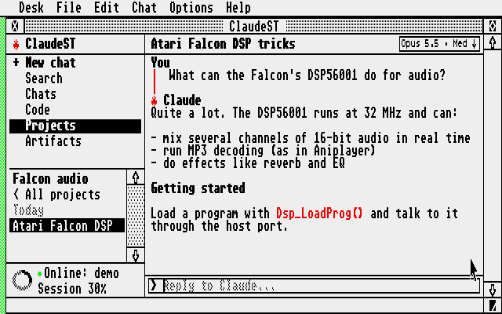
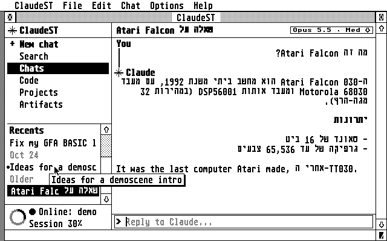
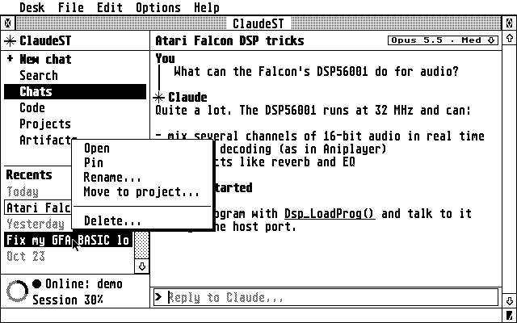
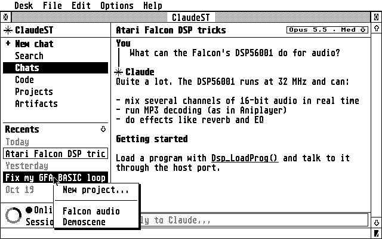
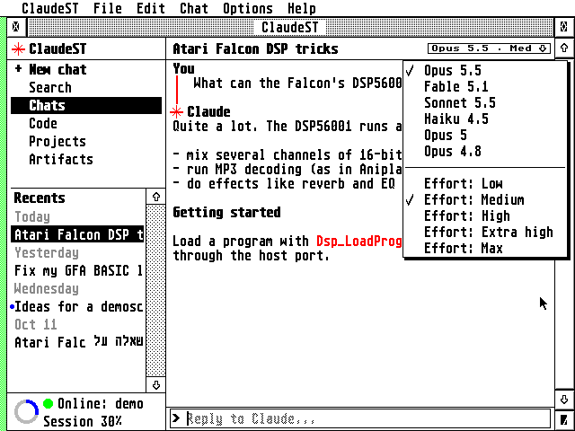
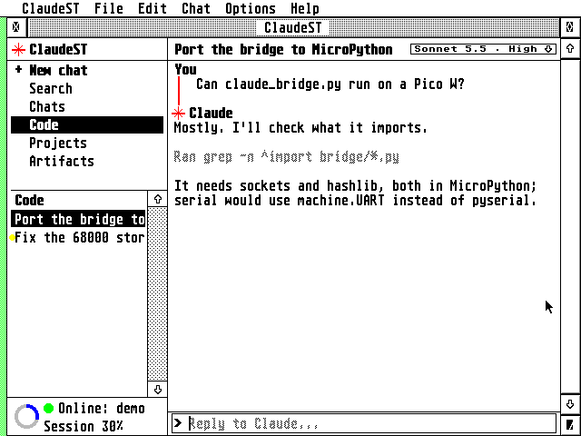
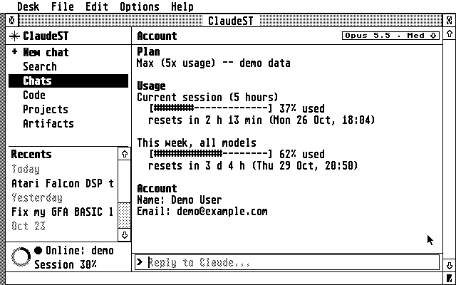
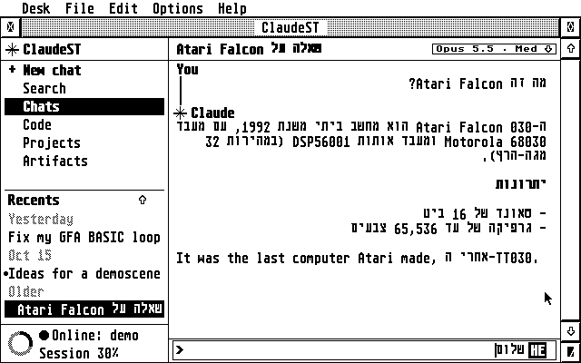
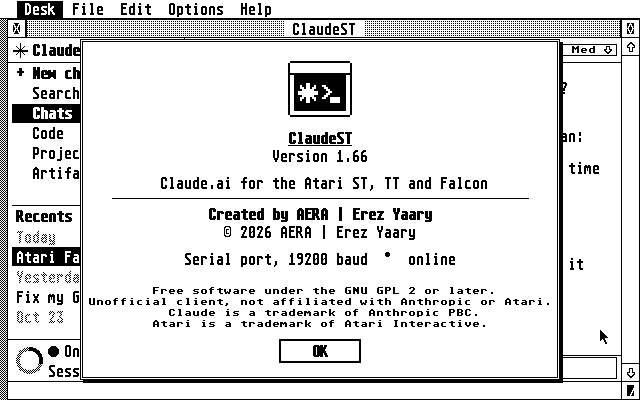
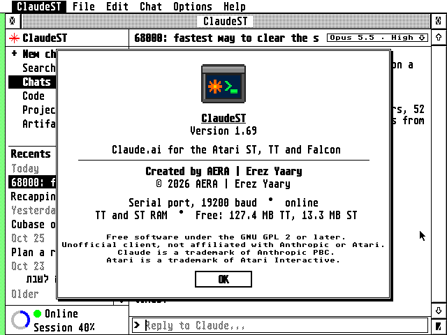

# ClaudeST user guide

This guide covers installing, then each part of ClaudeST, then
troubleshooting, settings and building. The screenshots show sample
chats from the bridge's demo backend (`tools/docshots.py` takes them).

- [Installing](#installing)
- [The window](#the-window)
- [Chats, projects and search](#chats-projects-and-search)
- [Right-click menus](#right-click-menus)
- [Model and effort](#model-and-effort)
- [Code: Claude Code sessions](#code-claude-code-sessions)
- [Artifacts](#artifacts)
- [Account, plan and usage](#account-plan-and-usage)
- [Attaching files](#attaching-files)
- [Hebrew](#hebrew)
- [All keys](#all-keys)
- [Settings (CLAUDEST.INF)](#settings-claudestinf)
- [What is stored where](#what-is-stored-where)
- [Troubleshooting](#troubleshooting)
- [The bridge on another computer](#the-bridge-on-another-computer)
- [Serial cables and ports](#serial-cables-and-ports)
- [Icons](#icons)
- [Building](#building)

## Installing

The [README](../README.md#getting-started) says what you need and how
to get the session key. On the Pi, in your home folder:

```sh
sudo apt install -y git      # Raspberry Pi OS Lite only: it comes without git
git clone https://github.com/whomper/AERA-Gateway.git
cd AERA-Gateway
./update-pi.sh
sudo gateway/aera-gateway install claude --network --atari 192.168.1.20
```

Put the Atari's address in place of `192.168.1.20`. The installer asks
for the session key and runs the bridge as a service that starts at
every boot.

Or the short way, every AERA gateway on the Pi in one line, ClaudeST's
bridge among them (it also sets up the gateways of ECal and EContact,
EFTP and EWeb, which do nothing until those apps use them):

```sh
sudo apt install -y git && git clone https://github.com/whomper/AERA-Gateway ~/AERA-Gateway && ~/AERA-Gateway/update-pi.sh --allow 192.168.1.20
```

`update-pi.sh` makes `aera-gateway` a command, so from then on
`sudo aera-gateway` works in any folder.

- **To update** the Pi, when a release's notes say the bridge changed:
  `cd ~/AERA-Gateway && ./update-pi.sh`. It keeps every setting.
- **To check** what runs, and which ClaudeST release:
  `gateway/aera-gateway status` in the same folder.

On the Atari, copy `CLAUDEST.PRG`, `CLAUDEST.HYP` and `CLAUDEST.REF`
into one folder and run `CLAUDEST.PRG`. Choose **Options ▸ Settings…**,
pick **Network** and type the Pi's address, port 2323.

## The window

The sidebar on the left has **+ New chat**, **Search**, **Chats**,
**Code**, **Projects** and **Artifacts**, then the list for the chosen
area, with a scroll bar of its own at its right. The open conversation fills the right side, with the reply line at
the bottom. Drag the divider between them to resize the sidebar; the
pointer turns into a hand over it.

Where the AES can iconify windows (MultiTOS, MagiC, XaAES, N.AES), the
window has the iconify button: ClaudeST shrinks to its icon, with *busy*
under it while Claude answers and *offline* when the bridge isn't there.
Replies still come in while it is iconified.



- **Status area** (bottom left): a dot for the connection, green when
  online and red when not (filled or hollow in black and white), with
  *Connecting…*, *Online* or *Offline: …* beside it. With claude.ai, a
  ring next to it fills clockwise as you use up the current session
  (claude.ai's 5-hour limit): blue, turning red from 90%, on a grey track
  in 16 colours; black on a dotted grey track with fewer colours. Below, *Session
  30%* and, when the sidebar is wide enough, the time until it resets.
  The bridge checks after each reply, at most every two minutes while
  you use ClaudeST, and every five minutes while the window is left
  alone. Click the area for the full Account page.
- **Left open,** ClaudeST keeps the status true. Every five minutes the
  bridge also checks that claude.ai still answers: if it doesn't, the
  status says *claude.ai silent*, or *Not signed in to claude.ai* when
  the session key has stopped working, and *Online* again once it's
  back. When nothing has passed for 30 seconds, ClaudeST asks the
  gateway whether it's still there; with no answer in 20 seconds the dot
  goes red and the status says *Gateway silent*, and ClaudeST keeps
  trying until the gateway answers. Over a serial cable this is the only
  way to tell that the Pi has gone.
- **Notices:** short messages such as *Loading chat...* or *Renamed*
  appear in grey at the right of the title bar for a few seconds.
- **Tooltips:** rest the mouse on a name that's cut off, in the sidebar
  or the title bar, and a tooltip shows all of it.
- **Code:** as on claude.ai, a code block (between `[bash]` or `[code]`
  and `[end]`) is shown in blue, and code within a sentence, such as a
  command or a file name, in red. With four colours, which have no blue,
  code blocks are green; in black and white, code within a sentence is
  underlined. **Edit ▸ Copy Claude's answer** puts its backticks back.



- **Switching area** empties the list at once, showing *Loading...* or
  the bridge's progress until the new list arrives. It also clears the
  conversation pane, so what you type next starts a new chat.
- **Scrolling:** the scroll bar, `↑` `↓`, `Shift+↑/↓` by page, and
  `Clr/Home` / `Shift+Clr/Home` for the top and bottom.

## Chats, projects and search

- **Chats** lists your recent chats under date headings, as on claude.ai:
  **Pinned** first (pinned chats also show a small diamond), then
  **Today**, **Yesterday**, a date such as **Oct 4** for each of the
  last seven days, and **Older** for the rest. Project chats, search
  results and Code sessions are grouped the same way. The headings can't
  be clicked, and `Tab` skips them.
- **Unread chats** have a small dot to the left of their name (blue in
  16 colours): a reply came in since you last read the chat, on
  claude.ai or on the Atari, for example one that finished on the
  website or in the background. Opening it removes the dot. claude.ai
  keeps no read time for older chats, so those never get a dot. Reading a
  chat on the Atari doesn't mark it read on claude.ai.
- **Projects** lists your projects. Opening one lists its chats, with
  **< All projects** at the top. A new chat started there is created in
  that project.
- **Search** (`F5`) empties the list and turns the reply line into
  *Find:*. Type words from a chat's title and press `Return`.

A long conversation shows its last 40 messages.

## Right-click menus

Right-click an item, or pick it with `Tab` and press `Insert`. The item
is highlighted while its menu is open.

| Item | Menu |
|------|------|
| Chat | Open, Pin/Unpin, Rename…, Move to project…, Delete… |
| Project | Open, Pin/Unpin, Rename…, Archive, Delete… |
| Code session | Open, Rename…, Archive |
| Artifact | Open, Save to disk… |



**Move to project…** lists your projects, with **New project…** at the
top, above a line. **New project…** asks for a name, creates the project
and moves the chat into it.



**Rename…** opens a dialog with the current name: edit it and press
`Return`, or `Undo` to cancel (`Esc` empties the box, as in any GEM
dialog). A name can be longer than the box, up to
71 characters: the text scrolls with the cursor, and `Shift+←` and
`Shift+→` go to its start and end. **Delete…** always asks first. In menus,
the arrow keys and `Return` work too, and `Esc` closes them.

## Model and effort

The chip at the right of the title bar shows the open chat's model and
effort, such as **Opus 5.5 · Med**. Click it, or press `F9`, for the
menu: the models, then the effort levels that model supports.



- **Models offered:** Opus 5.5, Fable 5.1, Sonnet 5.5, Haiku 4.5, Opus 5
  and Opus 4.8. A chat on an older model, such as Sonnet 4, adds that
  model to the menu.
- **Effort:** Low, Medium, High, Extra high and Max. Higher effort means
  more thinking: slower and more thorough. The default is Medium for
  Opus 5.5 and High for the others. Haiku and models older than the 4.5
  family have no effort setting; Opus 4.6 and Sonnet 4.6 have no Extra
  high, and Opus 4.5 has only Low, Medium and High.
- **Each chat keeps its own model and effort.** Opening a chat, a
  project's chat or a Code session shows the model and effort claude.ai
  has for it. If claude.ai has no effort for it, the chip shows the one
  you last chose for that chat, or else the model's default. Changing
  them changes that chat, and also becomes the choice for new chats,
  which is saved in `CLAUDEST.INF`.
- **claude.ai:** new chats start on **Default model**, your account's
  own choice, until you pick one. A chat's effort is read from, and
  saved to, the chat's own settings on claude.ai, so the website shows
  the same. The Pi also remembers the effort you choose for each chat
  and Code session, in `/var/lib/claude-st/chat-effort.json` (the 500
  most recent), for chats where claude.ai doesn't report one.
- **API backend:** the model and effort go with every request and are
  stored with each chat.

## Code: Claude Code sessions

**Code** (`F6`) lists your Claude Code sessions from claude.ai/code,
newest first. As on claude.ai, a dot to the left of a session says how
it is doing: **grey and pulsing** while Claude works on it, **yellow**
when it waits for you (a question, a permission), **blue** when it has
news you haven't read. On a monochrome screen the dots are black; the
waiting one is a little bigger. While a session works, ClaudeST checks
about every 20 seconds and its dot follows.



- **Reading:** your messages and Claude's replies. As on claude.ai, each
  run of tool calls is one grey line: the step's own description
  ("Waiting for the Release workflow"), or what was done ("Ran 2
  commands, used 2 tools", "Read claudest.c"). Tool output is left out.
  A long session shows its last 40 messages. One too long for the bridge
  to read in about 25 seconds shows what it read, with a note that later
  messages are not shown; claude.ai has them all.
- **Replying:** what you type goes to the open session, and Claude
  Code's replies appear as it works. If it's still working after 15
  minutes, ClaudeST stops waiting; open the session again later to see
  the rest.
- **Model:** the chip shows the session's own model. Changing it asks
  claude.ai to switch that session, without changing the model for your
  new chats.

## Artifacts

**Artifacts** (`F4`) lists the artifacts in your 40 most recent chats,
newest first: by when Claude last updated each one, then by when it was
created, under date headings like the chat list. claude.ai keeps
artifacts inside chats, so the bridge looks through them; the list shows
*Scanning chat 12/40* meanwhile. The
bridge keeps what it found in memory, so the next time only new or
changed chats are scanned. Artifacts from chats you delete, or that are
no longer among the 40 most recent, leave the list the next time it
loads.

It finds artifacts in every form claude.ai has used, including files
Claude made with a script, such as a Word cover letter.

- **Open** shows the source. A Word document shows its text.
- **Save to disk…** opens the GEM file selector with an 8.3 name such as
  `SNAKE_GA.PY` or `COVER_LE.DOC`. A file Claude made with a script, such
  as a Word document, is downloaded from claude.ai when you open or save
  it, and not kept on the Pi afterwards. Text is saved in the Atari character
  set with CR/LF line ends. Word, PDF and other binary files are saved
  unchanged.

To look further back than 40 chats, see
[extra bridge options](#extra-bridge-options).

## Account, plan and usage

Press `F8`, click the status line, or choose **Options ▸ Account…**.



- **Plan:** Free, Pro, Max (5x or 20x usage), Team or Enterprise.
- **Usage:** a meter for each limit, as on claude.ai's Usage page: the
  current 5-hour session, this week's usage, and any included cloud
  session credit, each with when it resets or expires, in the Pi's time
  zone.
- **Account:** your name, email, organisation and the date you joined.

With the API backend, the page shows the tokens used since the bridge
started instead.

## Attaching files

**Chat ▸ Attach file…** (`Ctrl+O`) picks a file in the file selector and
attaches it to your next message, as the paperclip does on claude.ai.
ClaudeST sends it to the gateway straight away ("Attaching 40%" in the
title bar), and the reply line shows it: `[NOTES.TXT]`, or `[2 files]`.
Type your message and press `Return`, or press `Return` on the empty
line to send the files alone. The message shows a grey **Attached**
line for each file, and so do messages with files in chats you open.

- **What can go:** any file, as on the website: text, pictures, PDFs,
  programs, archives. The limits are claude.ai's: up to 20 files in a
  chat, 500 MB each.
- **Over a serial cable** a file takes a while: about a minute for
  every 50 KB at 19200 baud. The network is much quicker.
- **To change your mind,** press `Backspace` on the empty reply line:
  the last attached file is removed.
- **In chats,** text files go in with their text, as the website sends
  them; other files are uploaded first. Pictures and PDFs Claude reads
  directly. Other kinds, such as a .PRG or a .ZIP, go to the chat's own
  computer, so turn on **code execution and file creation** in
  claude.ai's settings, as the website needs for them.
- **In Claude Code sessions,** a file goes into the message itself: a
  text file as it is, a picture or PDF as one, and any other file in
  base64, which Claude can decode into a file in the session.

## From other programs

A file handed to ClaudeST while it runs, by a desktop such as Thing,
jinnee or Gemini (or any program, with the AV protocol's VA_START), is
attached to your next message, as with **Attach file…**. Under
MultiTOS, MagiC or XaAES you can drag files onto the window too; text
dragged from another program goes into the reply line at the cursor.

## Copy and paste

Edit > Cut, Copy and Paste (`Ctrl+X`, `Ctrl+C`, `Ctrl+V`) use the GEM
clipboard, which other programs share:

- **`Ctrl+V`** puts the clipboard's text into the reply line at the
  cursor, its lines joined by spaces.
- **`Ctrl+C`** copies the reply line, and **`Ctrl+X`** cuts it.
- **With the reply line empty,** `Ctrl+C` copies Claude's last answer, a
  line for each paragraph, ready to paste into EMail or a text editor.
  **Edit > Copy Claude's answer** does the same.
- **In the rename and new project boxes, and the Settings fields,** the
  same keys work on the whole text, even where it is longer than the box.

## Hebrew

TOS has no right-to-left text support, so ClaudeST lays it out itself.
A paragraph that starts in Hebrew is right-aligned and reads right to
left, with English words and numbers inside it kept in order. The same
applies to titles in the sidebar and the title bar, and to the reply
line.



**Typing Hebrew:** press `F10`, or choose **Options ▸ Hebrew keys**. The
letter keys then type Hebrew in the Israeli SI-1452 layout, and an
**HE** badge shows in the reply box. Shift still types English capitals.
Keys are mapped by position, so any national Atari keyboard works.

The Atari font has only the plain letters, so the bridge drops vowel
points (niqqud) and turns maqaf, geresh and gershayim into `-`, `'` and
`"`.

## Font

**Options ▸ Font…** opens the Font dialog all the AERA programs share,
laid out as Atari font selectors are: the **Family** list on the left;
beside it the **Style** list (Regular, Italic, Bold…) and the **Size**
list; then the **Type** line (bitmap, Speedo,
TrueType or Type 1, and where its Hebrew comes from) and a sample in the
chosen font. The font is used for everything in ClaudeST's window: the
sidebar, the title bar, the conversation and the reply line. Menus and
dialogs keep the system font.

- **The system font** comes in two sizes, 8×8 and 8×16. 8×8 fits twice
  as many lines on an ST high or a Falcon VGA screen.
- **GDOS fonts:** with a GDOS such as NVDI or SpeedoGDOS, its fonts are
  listed too. ClaudeST lays text out in character cells, so it needs a
  fixed-width font: only those are listed, by family, with the styles
  and sizes each one has. The first time, ClaudeST measures each font
  ("Looking for fixed-width fonts" in the dialog; it can take a while
  with many vector fonts) and keeps the answers in `CLAUDEST.FNT` next
  to `CLAUDEST.PRG`, so the dialog opens quickly afterwards and only new
  fonts are measured. Delete `CLAUDEST.FNT` to measure them all again.
- **Hebrew letters:** fonts keep them in different places: the standard
  Atari font (TOS, EmuTOS) at the Atari character set's, Israeli system
  fonts and many GDOS fonts where ISO-8859-8 or DOS 862 put them. If
  Hebrew shows as other symbols, choose where your font keeps them in
  **Options ▸ Settings**, under *Hebrew in fonts*: Atari, ISO 8859 or
  DOS 862. A vector font (Speedo, TrueType, Type 1) is asked through
  NVDI 5 for its Hebrew letters by Unicode, as FreeMono and Liberation
  Mono have them; the Type line then says so. A vector font without
  Hebrew, or without NVDI 5 to ask, has those letters drawn in the
  system font, in the same cells.

Keys in the dialog: `Tab` (and `←` `→`) move between Family, Style and
Size; `↑` `↓` move in a list, `Clr/Home` to its top; a letter goes to
the next family starting with it (`C` for Courier). `Return` is OK and
`Esc` cancels. A double click on a row
also picks it.

## Help

`CLAUDEST.HYP` is a short hypertext of this guide: setup, every part of
the window, the keys, the settings and troubleshooting. Keep it next to
`CLAUDEST.PRG` (or in the viewer's help folder); with EHypView, ST-Guide
or HypView running (as an accessory, or as a program under MultiTOS or
MagiC), `Help` in ClaudeST opens it. Under MiNT or MagiC, the viewer
named by `STGUIDE=` in the AES's environment (`setenv STGUIDE
C:\HYPVIEW\HYPVIEW.APP` in XAAES.CNF, `#_ENV STGUIDE=` in MAGX.INF) is
asked first, and started when it isn't running. Without a viewer, `Help` says how to
get one and offers ClaudeST's keys instead (also **Help ▸ Keys…**). It also
opens on its own in any of them.

## All keys

| Key | Does |
|-----|------|
| `F1` / `Ctrl+N` | New chat |
| `F2` | Chats |
| `F3` | Projects |
| `F4` | Artifacts |
| `F5` / `Ctrl+F` | Search chat titles |
| `F6` | Code |
| `F8` | Account |
| `F9` | Model and effort |
| `F10` | Hebrew keyboard on or off |
| `Tab` / `Shift+Tab`, `Return` | Pick and open a sidebar item |
| `Insert` | The picked item's menu |
| `←` `→`, `Shift+←/→`, `Ctrl+←/→` | Move in the reply line: by character, to the start or end, by word |
| `Shift+Delete` | Clear the reply line (`^X` cuts it to the clipboard) |
| `Esc` | Empty the search box (in Search), and let go of the item picked in the sidebar. It never empties the reply line. In a dialog: empties the box with the cursor; in a dialog without one, or an alert, cancels |
| `Undo` | In any dialog: Cancel (as the dialog window's closer) |
| `Backspace` on the empty reply line | Remove the last attached file |
| `Ctrl+O` | Chat ▸ Attach file…: attach a file to the next message |
| `Ctrl+R` | Reconnect to the bridge |
| `Ctrl+,` | Options ▸ Settings: the gateway's address and port, or the serial port |
| `Ctrl+C`, `Ctrl+X`, `Ctrl+V` | Copy, cut, paste the reply line (`Ctrl+C` with it empty: Claude's last answer) |
| `Help` | This help (`CLAUDEST.HYP`) in EHypView, ST-Guide or HypView (without one: how to get one, or the keys). The **Help** menu has the same, and **Keys…** |
| `Ctrl+U`, `Ctrl+Q` | File ▸ Close window, Quit: closing ClaudeST's only window quits |
| `Ctrl+W` | The next window: ClaudeST has one, so nothing |

In the reply line, `/connect 192.168.1.10` (or `/connect host:port`)
sets the gateway address, and `/serial` switches to the serial port.

## Settings (CLAUDEST.INF)

**Options ▸ Settings…** (`Ctrl+,`) sets how ClaudeST reaches its gateway:
**Network** (through STinG) with the gateway's address and port, or
**Serial** with the speed, and where your fonts keep the Hebrew letters
(*Hebrew in fonts*: Atari, ISO 8859 or DOS 862; see [Font](#font)). Tab
moves between the two fields, `Esc` or `Clr/Home` empties the one with
the cursor, Return is OK and `Undo` cancels. The dialogs and alerts have
the AES's 3D look where it has one (TOS 4, MagiC, XaAES, EmuTOS in 16
colours or more), as every other program's there; there is no setting
for it.

ClaudeST saves its settings to `CLAUDEST.INF`, next to `CLAUDEST.PRG`
(strictly, in the folder that is current when ClaudeST starts, which the
desktop sets to the program's own), as soon as you change them, in the format of the other AERA programs: a
`[OPTIONS]` part, one `NAME=value` per line, and a `;` note above each.
You can also edit it in any text editor; lines ClaudeST doesn't know are
kept. A `CLAUDEST.INF` from before 1.38 (`tcp 192.168.1.10 2323` and so
on) is still read, and written in the new form the next time.

| Setting | Set by |
|------|--------|
| `LINK=network` or `serial` | Options ▸ Settings, Options ▸ Network (STinG) / Serial port, `/connect`, `/serial`. Without a `CLAUDEST.INF`, ClaudeST uses the serial port |
| `HOST=192.168.1.10`, `PORT=2323` | Options ▸ Settings, `/connect` |
| `BAUD=19200` (or 9600, 4800) | Options ▸ Settings, or the baud items in Options |
| `SERIALPORT=0` | edit by hand, on a TT or Falcon only to use another serial port than the one TOS has chosen (0, the default): 6 = MFP (TT Modem 1), 7 = SCC B (Modem 2, the Falcon's Modem port), 8 = TT-MFP (Serial 1), 9 = SCC A (Serial 2) |
| `HEBREW=1` | `F10` / Options ▸ Hebrew keys |
| `FONT=1,8` | Options ▸ Font: the font's id (1 = the system font) and size (8 or 16 for the system font's two sizes) |
| `HEBFONT=0` | Options ▸ Settings, *Hebrew in fonts*: where the system and bitmap fonts keep Hebrew (0 Atari, 1 ISO-8859-8, 2 DOS 862) |
| `SIDEBAR=240` | dragging the divider (width in pixels; 0, the default: ClaudeST's choice) |
| `MODEL=claude-sonnet-5-5`, `EFFORT=max` | the model chip / `F9` (empty, the default: claude.ai's default model and that model's effort) |

The window always opens full screen with a new chat.

## What is stored where

| Where | What |
|-------|------|
| claude.ai | Your chats, projects, artifacts and Code sessions. The bridge fetches them each time you open them; with claude.ai, no chat is stored on the Pi. |
| Pi: `/etc/claude-st/claude-st.env` | The session key (or API key) and the bridge's options, readable only by root and the bridge |
| Pi: `/var/lib/claude-st/chat-effort.json` | The effort you chose for each chat and Code session |
| Pi: `/var/lib/claude-st/chats/` | Only with the API backend: your chats, one file each |
| Pi: the bridge's memory | The artifacts found in your recent chats, to load the list quickly; gone when the bridge restarts |
| Pi: the log (`journalctl -u claude-st`) | Connections, errors, model changes and usage figures; not what you or Claude write |
| Atari: `CLAUDEST.INF` | ClaudeST's settings |
| Atari: `CLAUDEST.FNT` | Which GDOS fonts are fixed-width, so the font selector needn't measure them again |
| Atari: `CRASH.LOG` | What happened, if ClaudeST ever crashed (next to `CLAUDEST.PRG`) |

The open conversation lives only in the Atari's memory while ClaudeST
runs.

## Troubleshooting

All commands run on the Pi.

| Problem | What to do |
|---------|-----------|
| *Connecting…* never turns into *Online* | Check `systemctl status claude-st`, the address in Options ▸ Settings, and that the Atari's address matches the installer's `--atari` |
| Slow over the network (attaching files, long chats) | Set the Delay in `STING.CPX` to suit the machine: 10 on a Falcon or TT, 25 to 50 on an ST, as STinG's manual says. STinG looks at the network card that often, so it sets the speed of every STinG program |
| "claude.ai has moved this chat to its new chat system, and ClaudeST could not open its new part" | claude.ai moves some chats to its newer chat system. ClaudeST normally continues them there, but this time claude.ai refused. `run --probe-chat CHAT_ID` (see below) shows why. Meanwhile, start a new chat, or continue that one on claude.ai |
| "Claude hasn't answered for 90 seconds", or a usage-limit message | Your claude.ai usage limit is reached (F8 shows it), so claude.ai can't answer until it resets; reading your chats still works. The message is sent: open the chat again later to see the answer |
| "claude.ai says too many requests (HTTP 429)" | claude.ai is limiting requests for a while. Wait a few minutes; F8 shows your usage |
| An error mentions the session key, or HTTP 401/403 | claude.ai logged you out: get a new key and run `sudo gateway/aera-gateway set-key` in the AERA-Gateway folder |
| Something else fails | Watch `journalctl -u claude-st -f` while you try again on the Atari |
| ClaudeST itself crashed (on the Atari) | It says so, writes what happened to `CRASH.LOG` next to `CLAUDEST.PRG` and quits, leaving the Atari running. A crash in the system or a driver still gives the bombs; TOS keeps a record of them, and ClaudeST adds it to `CRASH.LOG` the next time it starts. Send `CRASH.LOG` to the author. Under MiNT or MagiC, which handle crashes themselves, there is none |

These commands check the claude.ai side without showing any of your
content:

```sh
# the commands below are all run as the bridge's own user
run() { sudo -u claude-st bash -c 'while IFS="=" read -r k v; do case "$k" in [A-Z]*) export "$k=$v";; esac; done < /etc/claude-st/claude-st.env; exec /opt/claude-st/venv/bin/python /opt/claude-st/bridge/claude_bridge.py "$@"' run "$@"; }

run --probe cover        # chats with "cover" in the title: where they are, their tools, files and model
run --probe-code         # whether Claude Code sessions can be listed, and the newest one's model and effort
run --probe-chat CHAT_ID # one chat's settings (not its messages), and for a moved chat, its session
```

### Extra bridge options

To give the bridge options the installer doesn't set, such as
`--artifact-scan 300` (look through 300 chats for artifacts), add them
to `/etc/claude-st/claude-st.env` on a line of their own. The installer
keeps this line when it updates.

```sh
echo 'CLAUDE_ST_EXTRA=--artifact-scan 300' | sudo tee -a /etc/claude-st/claude-st.env
sudo systemctl restart claude-st
```

## The bridge on another computer

The bridge runs on any computer with Python 3, including macOS and
Windows.

```sh
cd bridge
pip install -r requirements.txt
export CLAUDE_SESSION_KEY='sk-ant-sid01-...'
python3 claude_bridge.py --tcp 0.0.0.0:2323 --allow 192.168.1.20   # network
python3 claude_bridge.py --serial /dev/ttyUSB0                     # serial
```

`--backend api` (with `ANTHROPIC_API_KEY`) uses the Anthropic API;
chats are then stored in `~/.claude-st/`. `--backend demo` uses sample
chats. `python3 claude_bridge.py --help` lists every option.

## Serial cables and ports

| Machine | Port |
|---------|------|
| ST, STE, Mega ST/STE | the 25-pin Modem (RS-232) port |
| TT | Modem 1 |
| Falcon 030 | the 9-pin Modem port |

Use a null-modem cable and a USB-to-RS-232 adapter on the Pi. To use the
Pi's GPIO UART instead, put a MAX3232 level-shifter board in between,
turn off the serial console in `raspi-config`, and install with
`--serial /dev/serial0`. The speed is 19200 baud, 8N1; change it in
**Options ▸ Settings** and give the Pi the same `--baud`.

A WiFi modem on the serial port also works in transparent TCP mode:
point it at the Pi's port 2323, keep ClaudeST on the serial link, and
install the Pi with `--network --atari <the modem's IP>`.

## Icons

**Desk ▸ About ClaudeST…** shows the About box, with a
colour icon on screens with 16 colours or more.





The icon is 32×32 pixel art, the family's way (each app its own object):
a terminal window with Claude's orange spark and a green prompt, drawn
in 256 colours, in TOS's 16 and in black and white. Picked on the
desktop, the colour one turns a step lighter with a yellow glow round
it. The release has it for the desktop (in the zip, in `icons/`):

| File | What it is |
|------|-----------|
| `CLAUDEST.RSC` | a resource file with a black-and-white icon (TOS 1 and 2) and a colour one in 16 and 256 colours (TOS 4), for TOS, EmuTOS, or NVDI with COLORVDI |
| `CLSTNV.RSC` | the same for NVDI with its own palette: its 256 colours differ from TOS's, so the colour icon is drawn on NVDI's |
| `CLAUDEST.ICN`, `CLAUDSMK.ICN` | the black-and-white image and its mask |

Copy the icon from `CLAUDEST.RSC` into `DESKICON.RSC` (or `DESKCICN.RSC`
for colour icons on TOS 4) with a resource editor, then install it for
`CLAUDEST.PRG` from the desktop.

## Building

You need an m68k GCC; the stock Debian/Ubuntu cross compiler works.

```sh
sudo apt install gcc-m68k-linux-gnu
make                     # -> binary/CLAUDEST.PRG (make -C st)
make test                # the bridge's tests and the right-to-left layout's, on the host
make help HCP=...        # -> binary/CLAUDEST.HYP (hcp: common/tools/build-hcp.sh)
make dist                # a release's files in dist/
```

`binary/` and `dist/` are what make builds; they are never committed.
`VERSION` in `st/claudest.c` holds the last release, which every build
shows. To release:
`tools/bump.py`, commit and push, then run the Release workflow
(Actions > Release > Run workflow, on main) with what is new:
`.github/workflows/release.yml` tags the commit `vX.Y`, tests, builds
the program and the help, and publishes them as a GitHub Release with
those notes. Pushing a tag `vX.Y` made with `git tag -a` does the same,
with the tag's message as the notes.

The program is freestanding C with its own startup code, AES, VDI and
STinG bindings, and 68000 helpers, so it needs no MiNTLib and no
resource file. That runtime, and the right-to-left layout, are shared
with the other AERA programs: they live in `common/`, a copy of
[AERA-Atari](https://github.com/whomper/AERA-Atari)'s `common/` folder.
Change them there and bring the copy up to date with
`tools/sync-common.sh`. `common/tools/elf2tos.py` turns the ELF into a
TOS program. An `m68k-atari-mint` toolchain also works:
`make CROSS=m68k-atari-mint-`.

### Running it in Hatari

```sh
tools/hatari-test.sh                 # demo chats, no account needed
CLAUDE_SESSION_KEY='sk-ant-sid01-...' tools/hatari-test.sh claudeai
MACHINE=Falcon tools/hatari-test.sh  # ST (the default), ST-1, TT or Falcon
MACHINE=ST:med tools/hatari-test.sh  # a machine with another screen
LINK=network tools/hatari-test.sh    # over STinG, as on the network
```

The machines are the AERA family's test machines, from
`common/tools/machines.py` (`machines.py list` shows them and their
screens): your own TOS images when `~/.aera/tos` has them (`tos104us.img`,
`tos306.img`, `tos404.img`), else EmuTOS 1.4, which the script downloads
the first time. It starts the bridge and boots
[Hatari](https://hatari.tuxfamily.org/) into ClaudeST, with the emulated
serial port connected to the bridge. Hatari has no network card: with
`LINK=network`, `FAKESTNG.PRG` from `common/tools/fakesting` (built by the
script, with the same cross-compiler) stands in for STinG. It tunnels its
TCP connections over the serial port to `serial_bridge.py`, which connects
to the bridge on TCP port 2323, as ClaudeST does on the Pi. FAKESTNG is for
the emulator only; never install it on a real Atari.

Hatari only connects the ST-style MFP serial port to the bridge, so on
the Falcon the script puts `SERIALPORT=6` in `CLAUDEST.INF`; a real
Falcon uses its Modem port, the one TOS chooses, so it needs no
`SERIALPORT` line.

### Recording a demo video

`tools/reel/record.py` records a demo in Hatari: the family's Falcon
(`common/tools/machines.py`) in 640×480, 16 colours, boots to the EmuTOS desktop with a ClaudeST icon, opens Claude
ST, opens a chat, and types a new question. The answer comes from
`tools/reel/reel_bridge.py`, a bridge with a scripted showcase account
and a pre-written reply, so the video needs no account. It needs Linux
with Hatari, Xvfb, xdotool and ffmpeg, and EmuTOS's `emuicon.rsc`
(`machines.py` fetches EmuTOS 1.4 itself):

```sh
tools/reel/record.py out/ --emuicon emuicon.rsc
```

It writes `claude-st-falcon.mp4` (1280×960) and `claude-st-reel.mp4`
(1080×1920, for phones). A recording is in [docs/demo](demo/); its
chats and answer are scripted demo content. `tools/icon/add_to_emuicon.py` adds the Claude
ST icon to EmuTOS's `EMUICON.RSC`, which also works on a real Atari
running EmuTOS.

### Retaking the screenshots

`tools/docshots.py` (after `make`) boots the family's ST in high and
medium resolution with the demo backend, and the Falcon in 16 colours
with the showcase account, and takes this guide's and the README's
pictures into `docs/`, and the help front page's into
`docs/help/WINDOW.IMG`. `--only about,code` takes just those. Look at
them before committing: a slow machine can leave one half drawn.

### Source layout

```
st/        the Atari program: claudest.c (UI and protocol), bidi_test.c
help/      CLAUDEST.STG, the ST-Guide help: make help (needs HCP) -> binary/CLAUDEST.HYP
bridge/    claude_bridge.py (links and protocol), backends.py (claude.ai,
           API, demo), atari_text.py (charset and Markdown), test_bridge.py
pi/        install.sh (hands on to gateway/aera-gateway) and the systemd service
gateway/   a copy of AERA-Gateway's installer, aera-gateway, which sets up
           the bridge (tools/sync-gateway.sh)
common/    the AERA programs' shared code (a git subtree of AERA-Atari):
           atari/ (start-up, C library, TOS traps, AES/VDI, STinG client),
           src/bidi.c (right-to-left), tools/ (elf2tos.py, machines.py,
           fakesting/, helpfront.py)
tools/     hatari-test.sh, sync-common.sh, sync-gateway.sh, bump.py,
           check_version.sh, docshots.py (the screenshots), icon/ (the
           desktop icon), reel/ (the demo video)
tests/     hatari/: disk_budget.sh, font_gdos.py and long_field.sh
           (README, Tests)
icons/     the desktop icon files (make icons, from
           common/icons/CLAUDEST.txt)
docs/      this guide, its screenshots, the demo recording and the help's
           front page (front.json, help/WINDOW.IMG)
binary/    what make builds for the Atari (not committed: the releases
           have it)
```

[PROTOCOL.md](../PROTOCOL.md) describes the line protocol between the
Atari and the bridge.
